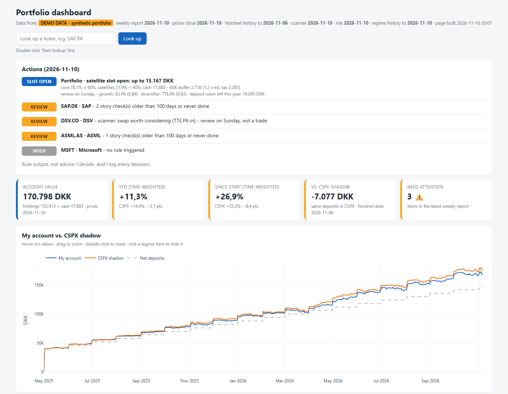

# beat-snp-portfolio

**Am I actually beating the S&P 500, or does it just look that way?**
A rules-based tracker for a Danish Nordnet aktiesparekonto (ASK) that answers that question honestly, then turns my own rules into a weekly report and a dashboard.



> Screenshots show the **synthetic demo portfolio** that ships with the project, not a real account.

---

## The problem

I hold a core position in an S&P 500 ETF (CSPX) plus a handful of single stocks ("satellites"). The broker shows a return figure, but it can't answer the question that matters: **would I have been better off just putting every deposit into CSPX?** It also can't tell me *which* positions helped or hurt, whether my portfolio is concentrated in one theme, or whether my own rules are being followed.

## The approach

The project is built in layers. Each one is a small Python script that reads the broker's exports and saves its results for the next layer.

1. **Holdings** (`portfolio.py`): reads Nordnet's holdings export (UTF-16, tab-separated, Danish decimal commas) and prints a clean table.
2. **Shadow portfolio** (`shadow_portfolio.py`): replays every deposit and withdrawal into CSPX on the same day. That gives a "what if I'd only bought the index" account, compared on both money and time-weighted return.
3. **Account rebuild** (`positions.py`): reconstructs shares and cash for every day from the raw transaction list, then reconciles the result against the broker's own daily value. This is how the data was validated.
4. **Attribution** (`position_results.py`): profit and loss per position, each against its own CSPX shadow (the same buys and sells, but in the index).
5. **Weekly check** (`weekly_check.py`): my rules from `rules.toml` (limits, price levels, story checks, analyst estimate revisions, ASK tax, calendar), plus an action panel: SELL, TRIM, REVIEW, ADD or HOLD per holding.
6. **Market regime** (`regime.py`): a 3-state hidden Markov model written from scratch in numpy, trained walk-forward (it only ever sees the past), with an honest out-of-sample test.
7. **Risk** (`risk.py`): underlying currency exposure, each holding's share of the portfolio's swings vs. its share of the money, stress tests and drawdown.
8. **Scanner** (`scanner.py`, `scan_core.py`): candidates pass hard gates (size, profits, price, sector, near-copy, ASK eligibility), get a percentile-rank score per role, and must fit the portfolio rules. "One in, one out" only flags a swap when the gap is large.
9. **Dashboard and lookup** (`dashboard.py`, `lookup.py`): a single offline HTML page, plus a local Streamlit page that checks any ticker against the same rules.
10. **One command** (`run_all.py`): runs everything in the right order.

## Key findings

- **The broker's benchmark overstated my lead by about 7 points.** On 2026 year-to-date, the broker's comparison showed a ~11-point lead over the S&P 500; against a proper CSPX shadow in DKK the lead was ~4 points, so the broker's benchmark overstated it by about 7 points.
- **Attribution changed the story.** One position created almost all of the lead over the index, and another erased most of it. The portfolio-level number hid both.
- **The regime model predicts volatility, not returns.** In the walk-forward test, "stressed" periods were followed by clearly bumpier months, but *not* by worse returns. So the regime is shown as information only and never triggers a trade.

## Design principles

- **Rules over opinions.** Limits, kill rules, price levels and scoring weights live in `rules.toml`. The code applies them the same way every week, and the action panel says so: *"Rule output, not advice: I decide, and I log every decision."*
- **AI as reviewer, not decider.** AI helped write and review the code. Every rule, threshold and decision is mine.
- **Weights locked before testing.** Scoring weights and new rules were committed *before* seeing their results, so they couldn't be tuned to look good.
- **Data validated against the broker.** The account rebuilt from raw transactions matches Nordnet's daily account value within 0.52% on every day, and the time-weighted 2026 YTD return matches Nordnet's figure (18.2% vs. 18.59%; the gap comes from data timing).
- **Information isn't a warning.** A check with no action attached is shown as ℹ️ and never counts toward "items need attention".
- **Private data stays out of the code.** Everything personal lives in a folder outside the repository (see below).

## My role

- Defined the problem and the success measure: beat CSPX in DKK, after Danish tax.
- Wrote the investment rules, limits and kill rules.
- Validated every layer against broker data and caught data errors: currency mismatches in EPS growth, ETFs scored on too few factors, a wrong ticker mapping.
- Decided what to keep or reject based on out-of-sample tests (e.g. the regime model is kept as context only).

## Tech stack

Python 3.11+ · pandas · numpy · yfinance (prices, FX, estimates) · matplotlib · plotly (offline dashboard) · Streamlit (lookup page) · python-dotenv · TOML for the rules.

## How to run it

```
py -m pip install -r requirements.txt
py run_all.py
```

With no setup it runs on **`demo_data\`**: a synthetic portfolio (CSPX plus 5 stocks over 18 months, with deposits, buys, one sale and dividends) in Nordnet's exact file format. The trades are made up, but the prices and dividends are real, so the numbers behave like a real account. `tools\make_demo_data.py` rebuilds it.

### With your own data

1. Make a folder anywhere, e.g. `C:\Users\me\Documents\portfolio-data`.
2. Put your Nordnet exports in it. Files are found by name, so the account number in the file name doesn't matter:
   - `Daglig udvikling*.csv`
   - `transactions*.csv`
   - `Aktietabel*.csv`
3. Copy `demo_data\rules.toml` into that folder and edit it: your limits, your theses, and under `[securities]` the Yahoo ticker for every ISIN in your transactions.
4. Copy `.env.example` to `.env` and set `BEAT_SNP_DATA_DIR=` to that folder.
5. Run `py run_all.py`. Everything the scripts write goes to `output\` inside your data folder.

To look up a single ticker, double-click `Start lookup.bat` and use the search box on the dashboard. The lookup has two modes: "New idea" (compared with the weakest satellite in the same role) or "Replace a holding" (head-to-head with a holding you pick). Either way it shows a side-by-side factor comparison, a plain-English fit check against every portfolio rule, and a three-part verdict (score, the deciding factors, and what the numbers can't tell you). "Add to watchlist" and "Add to scanner group" first save a dated backup of `rules.toml` in `rules_backup\`, then add only the new lines.

`.env`, CSVs, your `rules.toml`, `output\` and `rules_backup\` are all in `.gitignore`.

## What I'd do next

- Generalise the "semiconductors" concentration group into any number of named groups, each with its own money and risk caps.
- A decision log: record each action-panel decision and score the rules against what I actually did.
- Run `run_all.py` automatically every Monday and post a short summary.
- Unit tests for the rebuild and the time-weighted return, using the demo data as fixtures.
- Support more brokers' export formats.

## My results

<!-- To be filled in. -->

---

Built with AI assistance (Claude Code); problem definition, design, validation and decisions are mine.

**Not investment advice.** This is a personal project. Its output is the result of my own rules, not a recommendation to buy or sell anything.

License: [MIT](LICENSE)
